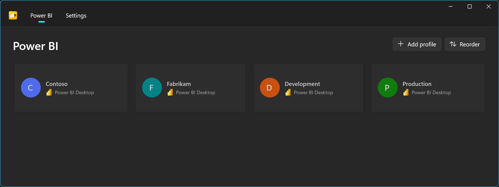
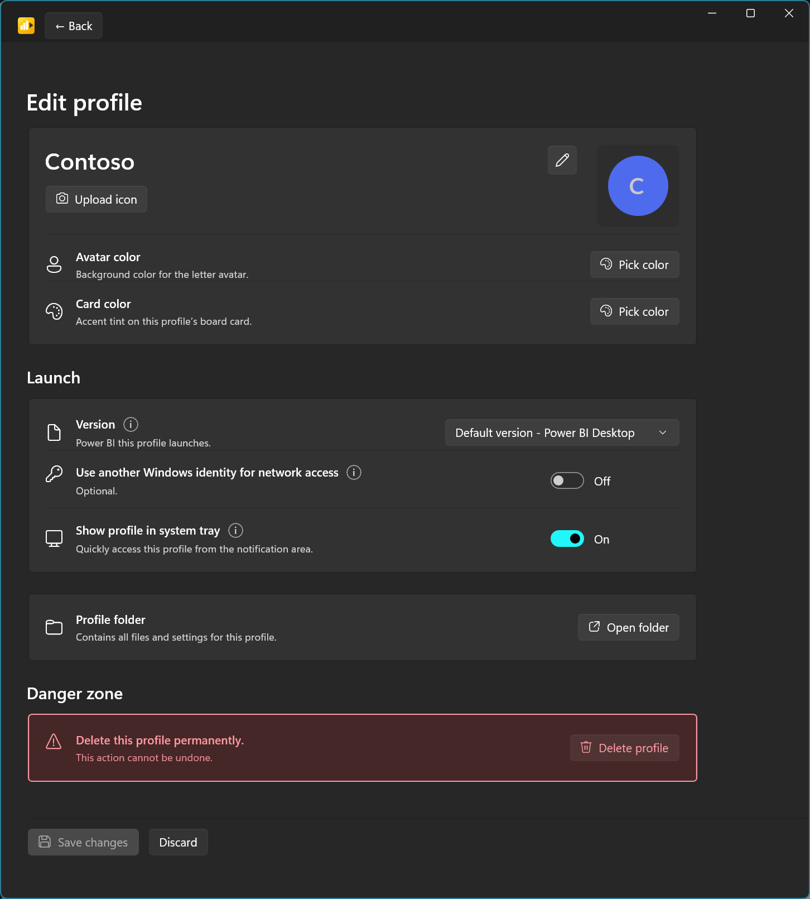
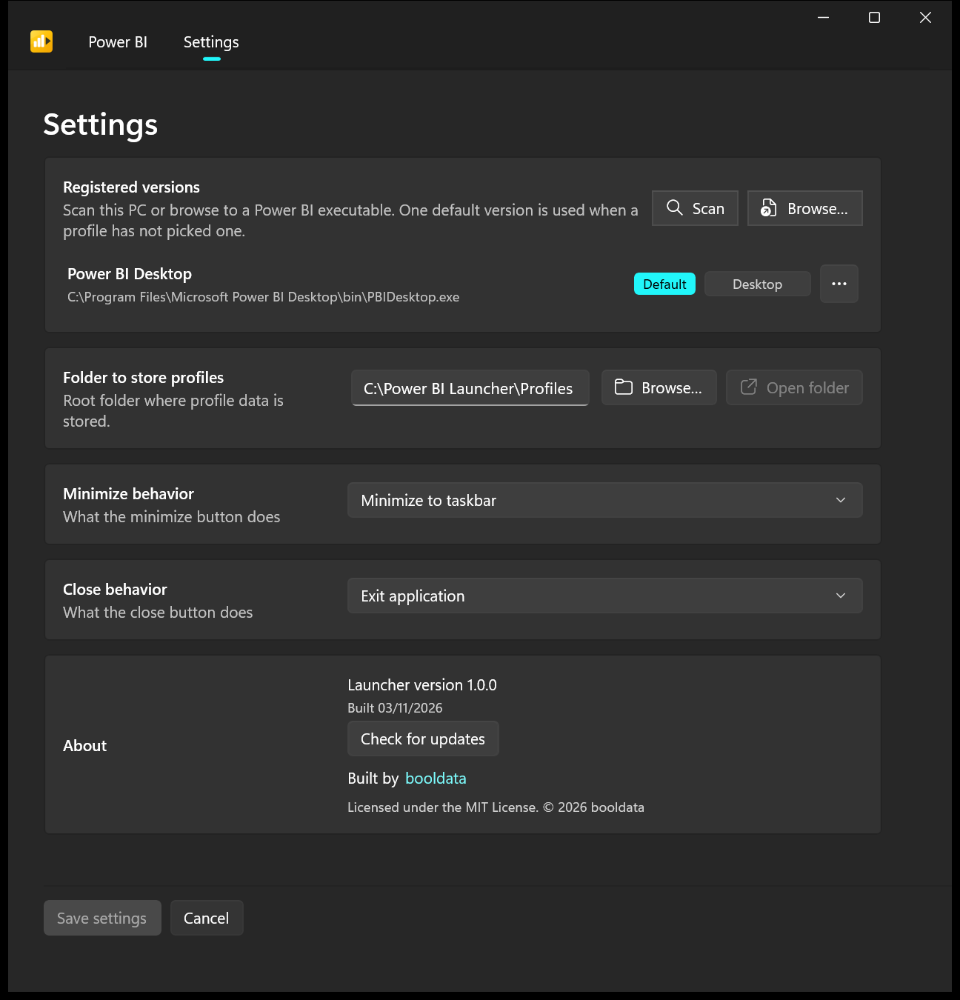

# Power BI Launcher

Windows app for running **isolated Power BI Desktop profiles**. One click each, without mixing sign-ins across clients or environments.

Built by [booldata](https://booldata.com).

## What it does

Power BI Desktop stores sign-in and cache in your Windows user profile. One Windows account and several tenants or clients usually means credential conflicts. Power BI Launcher gives each named **Profile** its own isolated folders, then starts Power BI Desktop in that environment from the board or the system tray.

Typical uses:

- Switching between client or tenant environments
- Keeping development and production work separate
- Running more than one Power BI Desktop instance, each with its own Microsoft account

## Features

- **Profiles:** create, edit, delete, and drag to set launch order
- **Version registry:** register downloaded and Report Server copies of Power BI Desktop. Pick a default, or pin one per Profile
- **Windows network identity:** optional credentials for Windows-authenticated Report Servers or data sources (password stays in Credential Manager)
- **System tray:** launch a Profile without opening the window

## Requirements

- Windows 10 or later
- [Power BI Desktop](https://www.microsoft.com/download/details.aspx?id=58494) (the downloaded version, not the Microsoft Store one) or Power BI Desktop for Report Server

## Install

1. Download the latest portable zip from [GitHub Releases](https://github.com/booldata/power-bi-launcher/releases/latest).
2. Unzip it into a folder you can write to, such as `%LOCALAPPDATA%\Programs\Power BI Launcher`. Not `Program Files`: the launcher saves its settings next to `Power BI Launcher.exe`.
3. Run `Power BI Launcher.exe`. No admin install and no separate Windows App SDK runtime.
4. Windows may show **Unknown publisher** or SmartScreen because portable releases are currently unsigned.

Verify a download with the published `.sha256` file. See [`Documentation/usage.md`](Documentation/usage.md#install).

## Upgrade

Exit the launcher from the tray, then unzip the new release **over the existing folder**, replacing files. If the folder still has `PBI Launcher.exe` from an older build, delete that file and run `Power BI Launcher.exe`. Your Profiles and settings live in `profiles.json` and `settings.json` in that folder, and the zip does not contain them. Unzipping to a new folder starts with no Profiles unless you copy those two files across. Details and uninstall steps: [`Documentation/usage.md`](Documentation/usage.md#upgrade).

## Getting started

On first launch the app asks you to **Scan** (or **Browse**) for Power BI Desktop, pick a **Default Version**, and save settings. After that:

1. Click **Add profile**, name it, and **Save changes**.
2. Click the card to launch Power BI Desktop in that Profile.
3. Use **More** on a card to edit, reorder, or delete. Use the tray for the same launches without opening the window.

Full walkthrough: [`Documentation/usage.md`](Documentation/usage.md).

## Known limitations

The Microsoft Store version of Power BI Desktop is not supported. Profiles work only with the downloaded installer and with Power BI Desktop for Report Server. Scan still lists a Store install, greyed out, and will not register or launch it. Details: [Microsoft Store version](Documentation/usage.md#microsoft-store-version).

## Privacy

The launcher has no telemetry and no account. Its only network request is to the GitHub Releases API, to check for a newer launcher version (at startup after setup, and when you choose **Check for updates**). Power BI Desktop itself connects to Microsoft as usual. See [Your data](Documentation/usage.md#your-data).

## Support

Report problems or ask for features on [GitHub Issues](https://github.com/booldata/power-bi-launcher/issues). Do not include passwords, client names, or tenant details.

## Documentation

**Using the app**

- [`Documentation/usage.md`](Documentation/usage.md): install, upgrade, uninstall, first run, Profiles, tray, Settings, where your data is stored
- [`CHANGELOG.md`](CHANGELOG.md): notable changes ([Keep a Changelog 1.1.0](https://keepachangelog.com/en/1.1.0/))

**Building and internals**

- [`Documentation/conventions.md`](Documentation/conventions.md): build, publish, tests, releases
- [`Documentation/architecture.md`](Documentation/architecture.md): architecture, file tree, `settings.json` / `profiles.json`
- [`Documentation/glossary.md`](Documentation/glossary.md): Profile / Version / Scan wording
- [`Documentation/scope.md`](Documentation/scope.md): purpose and out of scope
- [`AGENTS.md`](AGENTS.md): agent rules

## License

This project's original work is licensed under the [MIT License](LICENSE.md). The two Microsoft Power BI Desktop product icons in `Assets/` are not; see the additional notices in that file.

This project is not affiliated with Microsoft. Power BI is a trademark of Microsoft Corporation.
